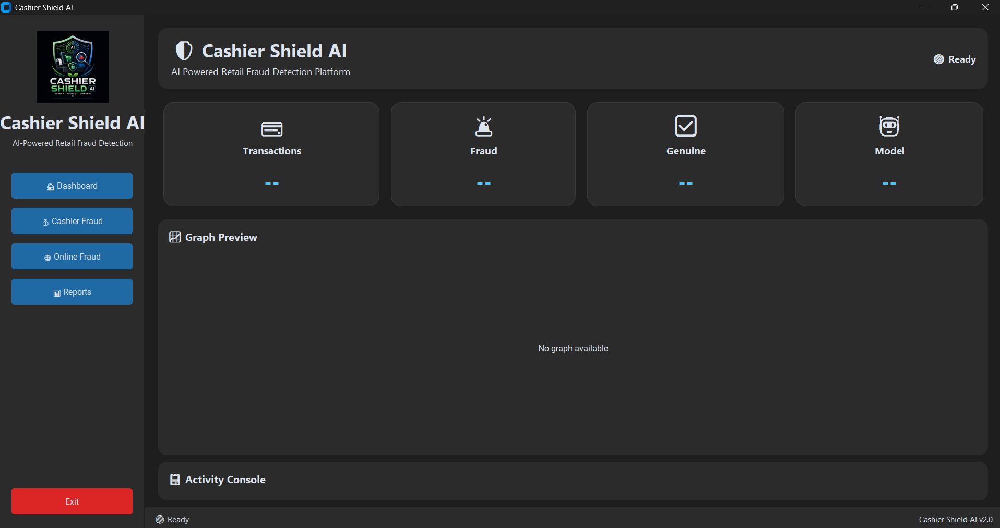
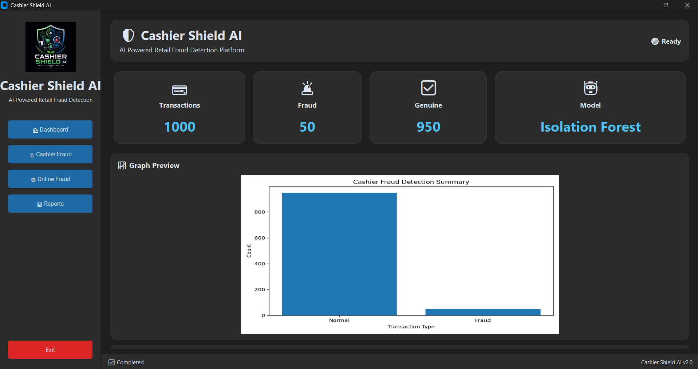
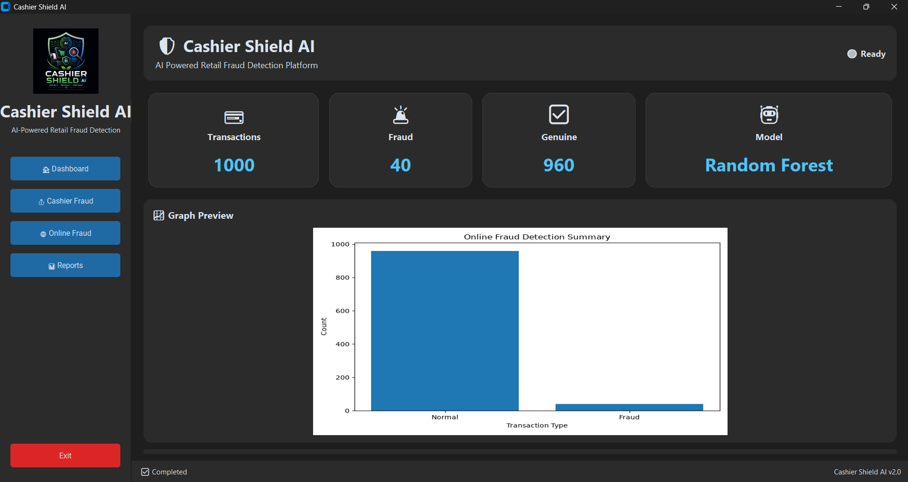
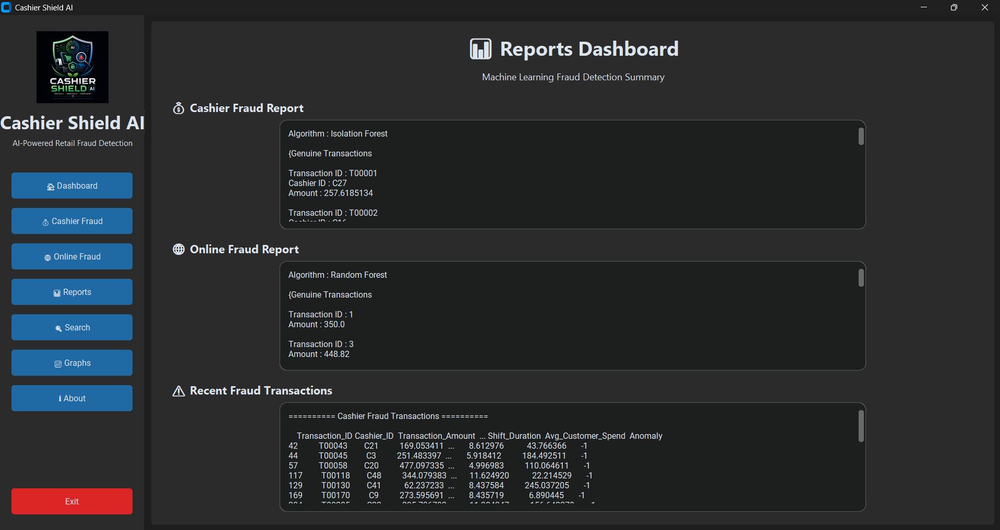
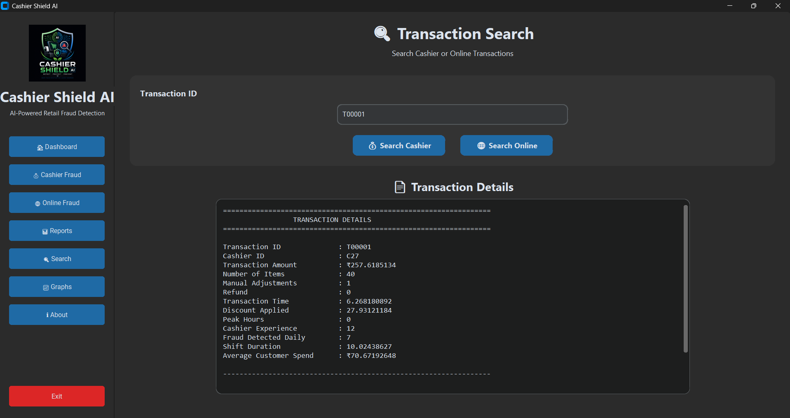
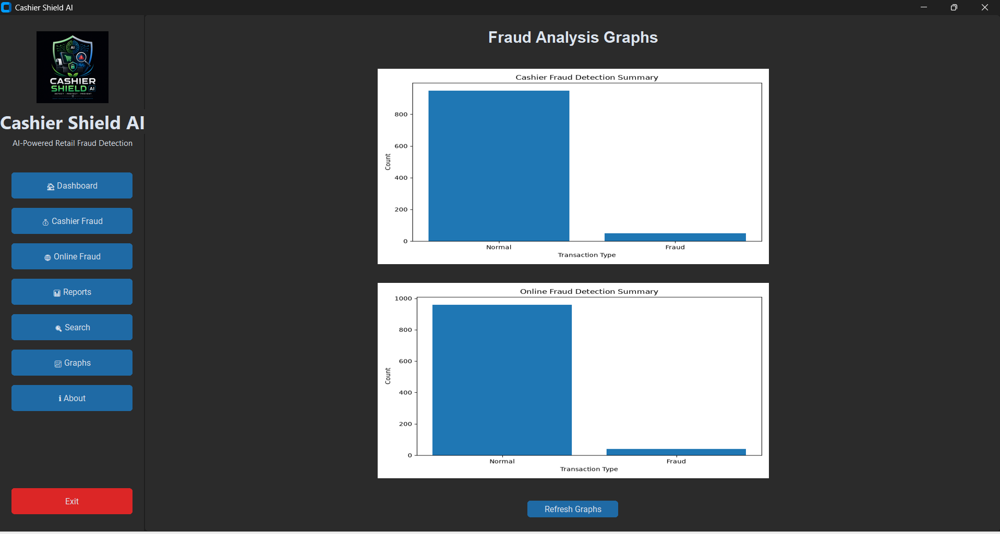
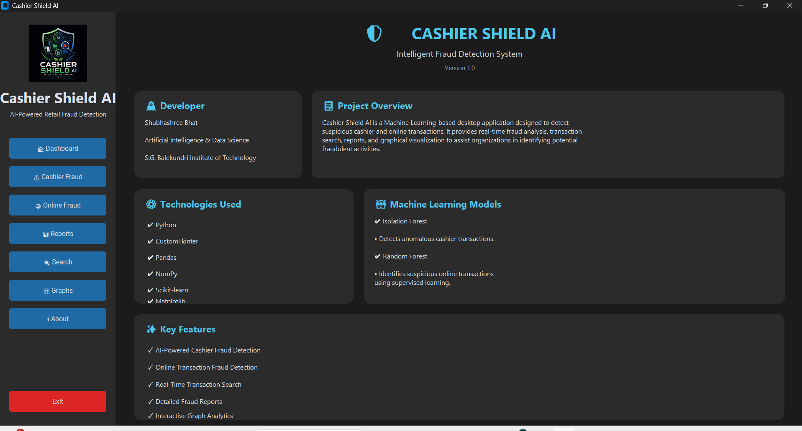

# 🛡️ Cashier Shield AI

> An AI-powered desktop application for detecting fraudulent cashier and online transactions using Machine Learning.

---

## 📌 Overview

Cashier Shield AI is a desktop application developed using **Python**, **CustomTkinter**, and **Machine Learning** to identify suspicious transactions.

The system provides an intuitive dashboard, fraud detection modules, transaction search, reports, and graphical analysis to help users monitor fraudulent activities efficiently.

---

## ✨ Key Features

- 💳 Cashier Fraud Detection
- 🌐 Online Transaction Fraud Detection
- 📊 Interactive Dashboard
- 📈 Fraud Summary Graphs
- 🔍 Search Transactions by ID
- 📑 Detailed Reports
- 🤖 Machine Learning-Based Detection
- 🖥️ Modern Desktop Interface (CustomTkinter)

---

# 🤖 Machine Learning Models

| Module | Algorithm |
|---------|-----------|
| Cashier Fraud Detection | Isolation Forest |
| Online Fraud Detection | Random Forest |

---

# 🛠️ Technologies Used

- Python
- CustomTkinter
- Pandas
- NumPy
- Matplotlib
- Scikit-learn
- Pillow

---

# 📸 Application Screenshots

## 🏠 Dashboard



---

## 💳 Cashier Fraud Detection



---

## 🌐 Online Fraud Detection



---

## 📑 Reports



---

## 🔍 Transaction Search



---

## 📈 Graph Analytics



---

## ℹ️ About



---

# 📂 Project Structure

```text
Cashier-Shield-AI/
│
├── assets/
│   ├── dashboard.png
│   ├── cashier_detection.png
│   ├── online_detection.png
│   ├── reports.png
│   ├── search.png
│   ├── graphs.png
│   └── about.png
│
├── controllers/
├── datasets/
├── graphs/
├── models/
├── results/
├── ui/
│   └── pages/
│
├── app.py
├── cashier_model.py
├── online_model.py
├── utils.py
├── requirements.txt
├── README.md
└── .gitignore
```

---

# 🚀 Installation

## 1. Clone the repository

```bash
git clone https://github.com/YOUR_GITHUB_USERNAME/Cashier-Shield-AI.git
```

## 2. Navigate to the project

```bash
cd Cashier-Shield-AI
```

## 3. Create a virtual environment

```bash
python -m venv venv
```

### Windows

```bash
venv\Scripts\activate
```

### macOS/Linux

```bash
source venv/bin/activate
```

## 4. Install dependencies

```bash
pip install -r requirements.txt
```

## 5. Run the application

```bash
python app.py
```

---

# 🎯 Future Improvements

- Database Integration
- Cloud Deployment
- Live Transaction Monitoring
- Explainable AI (XAI)
- PDF & Excel Report Export
- Email Notifications
- Multi-Branch Fraud Monitoring

---

# 👩‍💻 Developer

**Swati Patil**

Bachelor of Engineering  
Artificial Intelligence & Data Science

S.G. Balekundri Institute of Technology

---

# 📄 License

This project is intended for educational and portfolio purposes.

---

⭐ **If you found this project useful or interesting, consider giving it a star on GitHub!**
